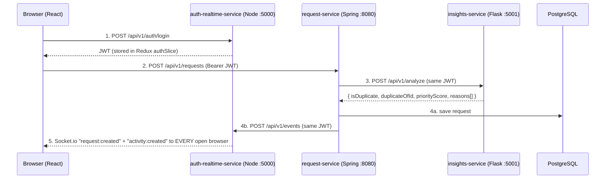

# FloodLink – Shared API Contract

> The single source of truth all four parts follow. Change an endpoint here first, then tell the team.

## 1. Services and ports

| Service                 | Tech                                      | Port | Owner    |
|-------------------------|-------------------------------------------|------|----------|
| frontend                | React (Vite)                              | 5173 | all (one feature folder each) |
| auth-realtime-service   | Node.js + Express + MongoDB + Socket.io   | 5000 | Person 1 |
| request-service         | Spring Boot 3 + PostgreSQL                | 8080 | Person 2 |
| insights-service        | Python Flask + SQLAlchemy (SQLite)        | 5001 | Person 3 |

All HTTP APIs are versioned under `/api/v1/`.

## 2. JWT rules

- **Issued ONLY by auth-realtime-service** (Node), at login and register.
- **Validated** by request-service (Spring) and insights-service (Flask), which never issue tokens.
- **Algorithm:** HS256. **Secret:** env var `JWT_SECRET`, identical in all three backends (≥ 32 characters).
- **Payload:**
  ```json
  { "userId": "6650a1f2c3d4e5f6a7b8c9d0", "name": "Priya", "email": "volunteer@floodlink.in", "role": "VOLUNTEER", "iat": 1764660000, "exp": 1764746400 }
  ```
  `userId` is the MongoDB id (a string). Roles: `CITIZEN`, `VOLUNTEER`, `ADMIN`.
- **Sending it:** header `Authorization: Bearer <token>`. Socket.io: `io(url, { auth: { token } })`. Only `/report` (a page opened as a normal browser link) also accepts `?token=<jwt>`.
- **Between services:** when request-service calls insights-service or auth-realtime-service, it **forwards the JWT of the user who made the request**, so every service checks every call the same way.

## 3. Standard error format (all services)

```json
{ "status": 400, "error": "Bad Request", "message": "contactPhone: must be a 10-digit phone number" }
```
`401` = missing/invalid token, `403` = wrong role, `404` = not found, `409` = conflict (already claimed, email taken), `502` = another service is down.

## 4. Main data flow



```
1. User logs in            Browser ──POST /auth/login──────────▶ Node      ──▶ JWT stored in Redux
2. User posts a request    Browser ──POST /requests────────────▶ Spring
3. Spring asks for insight Spring  ──POST /analyze─────────────▶ Flask     ──▶ duplicate flag + priority + reasons
4. Spring saves + notifies Spring  ──INSERT──▶ PostgreSQL;  Spring ──POST /events──▶ Node
5. Node pushes live        Node    ══Socket.io broadcast══════▶ every open browser updates its map instantly
```

If insights-service is down, Spring saves the request with priority 50 and reason "Insights service unavailable". If auth-realtime-service is down, the request is still saved but nobody gets the live push.

## 5. Shared object: HelpRequest (returned by request-service)

```json
{
  "id": 12,
  "type": "RESCUE",
  "description": "Elderly couple trapped on first floor, water rising",
  "latitude": 12.9815,
  "longitude": 80.2180,
  "address": "4th Main Road, Velachery",
  "peopleCount": 2,
  "contactName": "Lakshmi",
  "contactPhone": "9840012345",
  "status": "CLAIMED",
  "priorityScore": 54,
  "priorityReasons": ["RESCUE request: +40", "2 people affected: +4", "Urgent words (elderly, trapped): +10"],
  "duplicateOfId": null,
  "claimedBy": { "id": "6650a1f2c3d4e5f6a7b8c9d0", "name": "Priya" },
  "createdAt": "2025-12-02T10:15:00",
  "updatedAt": "2025-12-02T10:20:00"
}
```
- `type`: `FOOD` | `RESCUE` | `MEDICINE` | `SHELTER`
- `status`: `OPEN` → `CLAIMED` → `RESOLVED`
- `claimedBy` is `null` while OPEN.
- `address` convention: **"Street, Area"**. The text after the last comma is the *area*, used for hotspot stats and the live ticker.

---

## 6. auth-realtime-service (Node, :5000) – Person 1

Swagger UI: `http://localhost:5000/api-docs`

### POST /api/v1/auth/register – public
```json
{ "name": "Kavya", "email": "kavya@example.com", "password": "demo123", "phone": "9876543210", "role": "CITIZEN" }
```
`role`: `CITIZEN` or `VOLUNTEER` (admins can't self-register). Password ≥ 6 chars, phone exactly 10 digits.
Response `201`:
```json
{ "token": "eyJhbGciOiJIUzI1NiIsInR5cCI6IkpXVCJ9...", "user": { "id": "6650a1...", "name": "Kavya", "email": "kavya@example.com", "phone": "9876543210", "role": "CITIZEN" } }
```
Errors: `400` validation, `409` email already registered.

### POST /api/v1/auth/login – public
```json
{ "email": "volunteer@floodlink.in", "password": "demo123" }
```
Response `200`: same shape as register. Error: `401 "Wrong email or password"`.

### GET /api/v1/auth/me – logged in
Response `200`: `{ "id": "6650a1...", "name": "Priya", "email": "volunteer@floodlink.in", "phone": "9000000002", "role": "VOLUNTEER" }`

### POST /api/v1/events – logged in (called by request-service with the acting user's JWT)
```json
{ "event": "request:claimed", "data": { ...HelpRequest } }
```
`event` ∈ `request:created`, `request:claimed`, `request:resolved`, `request:updated`, `request:deleted` (for deleted, `data` is `{ "id": 12 }`).
Response `202`: `{ "delivered": true, "event": "request:claimed" }`
Side effects: Socket.io emits `event` with `data`; an ActivityLog entry is saved and emitted as `activity:created`.

### GET /api/v1/activity?limit=20 – logged in
Newest first, `limit` max 100. Response `200`:
```json
[ { "_id": "6650b2...", "event": "request:claimed", "requestId": 12, "actorName": "Priya", "area": "Velachery",
    "message": "Volunteer Priya claimed a rescue request in Velachery", "createdAt": "2025-12-02T10:20:00.000Z" } ]
```

### GET /api/v1/health – public
`{ "status": "UP", "service": "auth-realtime-service", "connectedClients": 2 }`

### Socket.io events (server → every connected browser)
| Event              | Payload            | When |
|--------------------|--------------------|------|
| `request:created`  | HelpRequest        | a request is saved |
| `request:claimed`  | HelpRequest        | a volunteer claims |
| `request:resolved` | HelpRequest        | a request is resolved |
| `request:updated`  | HelpRequest        | an admin edits |
| `request:deleted`  | `{ "id": 12 }`     | an admin deletes |
| `activity:created` | ActivityLog entry  | after each of the above (feeds the live ticker) |

---

## 7. request-service (Spring Boot, :8080) – Person 2

Swagger UI: `http://localhost:8080/swagger-ui.html` · Health: `GET /actuator/health` (public). Every `/api/v1` call needs a valid JWT.

| Method | Path                               | Role                          | Body / response |
|--------|------------------------------------|-------------------------------|-----------------|
| GET    | /api/v1/requests[?status=OPEN]     | any                           | `[HelpRequest]`, highest priority first |
| GET    | /api/v1/requests/{id}              | any                           | `HelpRequest` · `404` |
| GET    | /api/v1/requests/claimed/me        | VOLUNTEER                     | `[HelpRequest]` claimed by me |
| POST   | /api/v1/requests                   | any                           | create (below) → `201 HelpRequest` |
| PUT    | /api/v1/requests/{id}              | ADMIN                         | edit (below) → `200 HelpRequest` |
| DELETE | /api/v1/requests/{id}              | ADMIN                         | `204` |
| POST   | /api/v1/requests/{id}/claim        | VOLUNTEER                     | OPEN → CLAIMED · `409` if not OPEN |
| POST   | /api/v1/requests/{id}/resolve      | VOLUNTEER who claimed / ADMIN | CLAIMED → RESOLVED · `409` if not CLAIMED · `403` other volunteer |

### POST /api/v1/requests body
```json
{
  "type": "RESCUE",
  "description": "Elderly couple trapped on first floor, water rising",
  "latitude": 12.9815,
  "longitude": 80.2180,
  "address": "4th Main Road, Velachery",
  "peopleCount": 2,
  "contactName": "Lakshmi",
  "contactPhone": "9840012345"
}
```
Rules: all required; `description` ≤ 500 chars; `peopleCount` 1–1000; `contactPhone` exactly 10 digits.
Response `201` (insights already applied):
```json
{ "id": 18, "type": "RESCUE", "status": "OPEN", "priorityScore": 54,
  "priorityReasons": ["RESCUE request: +40", "2 people affected: +4", "Urgent words (elderly, trapped): +10"],
  "duplicateOfId": null, "claimedBy": null, "...": "other HelpRequest fields" }
```

### PUT /api/v1/requests/{id} body (ADMIN)
```json
{ "description": "Updated text", "address": "12 Gandhi Road, Velachery", "peopleCount": 3, "contactName": "Lakshmi", "contactPhone": "9840012345" }
```

### Claim / resolve example
`POST /api/v1/requests/12/claim` (no body) → `200`:
```json
{ "id": 12, "status": "CLAIMED", "claimedBy": { "id": "6650a1...", "name": "Priya" }, "...": "other HelpRequest fields" }
```
Error `409`: `{ "status": 409, "error": "Conflict", "message": "Request #12 is already CLAIMED" }`

---

## 8. insights-service (Flask, :5001) – Person 3

Swagger UI: `http://localhost:5001/apidocs` · every endpoint except health needs a JWT.

### POST /api/v1/analyze – any logged-in user (called by request-service)
```json
{
  "request": { "type": "RESCUE", "description": "Elderly couple trapped on first floor", "latitude": 12.9815, "longitude": 80.2180,
               "address": "4th Main Road, Velachery", "peopleCount": 2, "createdAt": "2025-12-02T10:15:00" },
  "recentRequests": [
    { "id": 7, "type": "RESCUE", "description": "Elderly couple trapped on 1st floor", "latitude": 12.9816, "longitude": 80.2181, "createdAt": "2025-12-02T09:55:00" }
  ]
}
```
`createdAt` optional (defaults to now); `recentRequests` may be empty. Response `200`:
```json
{
  "isDuplicate": true,
  "duplicateOfId": 7,
  "priorityScore": 54,
  "reasons": ["RESCUE request: +40", "2 people affected: +4", "Urgent words (elderly, trapped): +10",
              "Possible duplicate of #7: 92% similar text, 14 m away, 20 min apart"]
}
```
Duplicate = same type **and** ≤ 200 m (haversine) **and** ≤ 2 h apart **and** description similarity > 0.6 (difflib).
Priority = type (RESCUE 40 / MEDICINE 30 / FOOD 20 / SHELTER 15) + people (2 each, max 20) + waiting (5 per hour, max 15) + urgent words (5 each, max 25), capped at 100.

### GET /api/v1/stats – ADMIN
Reads current requests from request-service (forwarding the JWT) and combines them with the analysis history.
```json
{
  "totalRequests": 17,
  "requestsByType": { "RESCUE": 6, "MEDICINE": 4, "FOOD": 4, "SHELTER": 3 },
  "requestsByStatus": { "OPEN": 10, "CLAIMED": 4, "RESOLVED": 3 },
  "hotspotAreas": [ { "area": "Velachery", "count": 5 }, { "area": "Tambaram", "count": 2 } ],
  "averagePriority": 43.4,
  "averageResolveMinutes": 12.5,
  "totalAnalyses": 17,
  "duplicatesCaught": 1
}
```
`averageResolveMinutes` is `null` when nothing is resolved yet. `502` if request-service is unreachable.

### GET /report?token=<admin JWT> – ADMIN
Printable HTML page (Jinja2): summary cards, by type/status/area, and the last 10 analyses with their reasons.

### GET /api/v1/health – public
`{ "status": "UP", "service": "insights-service" }`

---

## 9. Additions (v1.1): presence, timeline, merging, suggestions

### HelpRequest: new fields
| Field | Meaning |
|-------|---------|
| `claimedAt`, `resolvedAt` | Timeline timestamps; `null` until that step happens (and for requests claimed before v1.1) |
| `mergedIntoId` | Set when this duplicate was merged into another request |
| `reportCount` | `1` + every report merged into this one ("Reported 3 times") |
| `status` | now also `MERGED` (a duplicate folded into its original; hidden from the map) |

**Stale rule (computed by clients):** an `OPEN` request older than 6 hours is "stale" and gets a highlighted marker.

### request-service: POST /api/v1/requests/{id}/merge – VOLUNTEER or ADMIN
Body optional: `{ "targetId": 16 }` (default: the request's `duplicateOfId`). Duplicate must be `OPEN`.
Response `200`: `{ "id": 16, "original": { ...HelpRequest, "reportCount": 2 }, "merged": { ...HelpRequest, "status": "MERGED", "mergedIntoId": 16 } }`
Errors: `400` no duplicate link and no targetId / merging into itself, `409` duplicate not OPEN or target already MERGED.
Broadcast as Socket.io event `request:merged` with the same body.

### auth-realtime-service: presence
- Socket.io, browser to server (VOLUNTEER only): `presence:update { latitude, longitude }`, `presence:stop`.
- Server to every browser: `presence:changed { onlineCount, volunteers: [{ userId, name, latitude, longitude, updatedAt }] }`. Coordinates are rounded to about 100 m; `null` when not shared.
- `GET /api/v1/presence` (logged in): the same object.

### insights-service
**POST /api/v1/suggest** (logged in): `{ "description": "...", "type": "RESCUE"?, "peopleCount": 2? }` returns
`{ "suggestedType": "RESCUE", "matchedKeywords": ["trapped"], "urgency": "HIGH|MEDIUM|LOW", "urgentWords": [...], "priorityPreview": { "type", "score", "reasons" } }`. Nothing is saved.

**GET /api/v1/stats** now also returns `requestsByStatus.MERGED`, `duplicatesMerged`, and
`areaBreakdown: [{ "area", "total", "OPEN", "CLAIMED", "RESOLVED", "averageResolveMinutes" }]`. Type and area counts leave out MERGED requests.

**Reason format:** every scoring reason ends in `": +<points>"` (e.g. `"RESCUE request: +40"`); the UI parses it to draw the breakdown.
