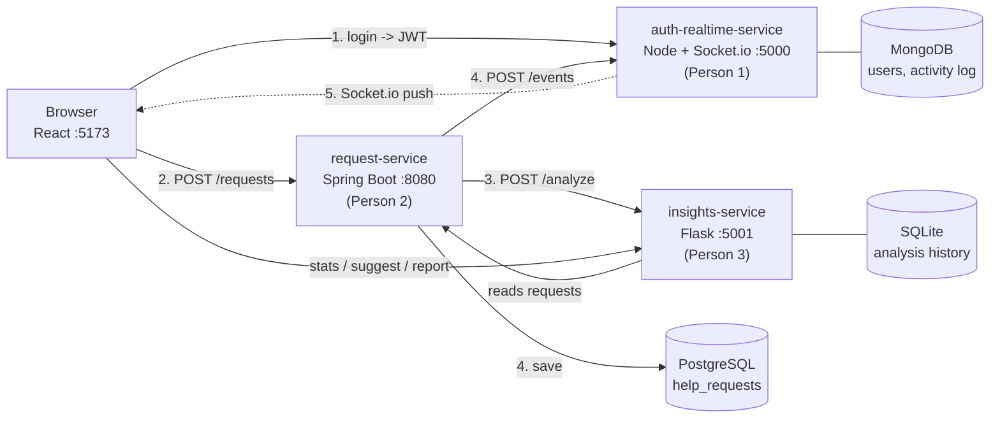

# FloodLink – Chennai Flood Response Coordinator

During the 2015 and 2023 Chennai floods, calls for help were scattered across WhatsApp groups and Twitter threads. The same family was posted ten times, old messages kept circulating after people were rescued, and volunteers couldn't tell who had already been helped.

**FloodLink** puts every help request on one live map:
- **Citizens** post a request in 3 quick steps (or one-tap **SOS** on a phone). Typing the description suggests the type and shows a **live priority preview**. Without a connection, the request is saved and sent automatically later.
- **Volunteers** see every request on a live, clustered map (or as a **heatmap**), filter by type, status, **near me** and **stale** (open 6+ hours), **claim** one, and work through a task board: Claimed, On the way, Resolved, with Google Maps directions.
- **Insights** flags likely **duplicates** (which volunteers can **merge**, so the original shows "reported 3 times") and gives every request a **priority score (0–100) with a breakdown of why**.
- **Everything is live** (Socket.io): new requests, claims, online volunteers as dots on the map, toasts, and browser alerts for priority above 70.
- **Admins** get a dashboard: KPI cards, charts by type, status and area, average resolve time per area, a hotspot heatmap and a live activity feed.

---

## Architecture



1. User logs in. **Node** checks the bcrypt password and returns a **JWT**, stored in Redux.
2. React calls `POST /api/v1/requests` on **Spring**, which validates the JWT.
3. Spring calls `POST /api/v1/analyze` on **Flask**: duplicate flag, priority and reasons.
4. Spring saves to **PostgreSQL**, then calls `POST /api/v1/events` on **Node**.
5. Node pushes the change over **Socket.io**, and every open browser updates instantly.

Every endpoint, body and example response is in **[CONTRACT.md](CONTRACT.md)** (section 9 lists the newest additions).

---

## Team split

| Person | Backend | Frontend | Features |
|--------|---------|----------|----------|
| **Person 1 – Accounts & Live** | `/auth-realtime-service` (Node, Express, MongoDB, Socket.io) | `frontend/src/app`, `features/auth`, `features/live` | Register/login, the only JWT issuer, event broadcasting, activity log, **volunteer presence** · app shell, dark theme, login/register, live stats bar, toasts, **browser alerts**, **offline queue**, **SOS button** |
| **Person 2 – Help Requests** | `/request-service` (Spring Boot, PostgreSQL) | `features/requests` | Request CRUD, claim/resolve, **timeline timestamps**, **merge endpoint** · map with clustering, heatmap, pulsing and stale markers, filter chips, nearest-first, 3-step post form, success screen, volunteer task board |
| **Person 3 – Insights** | `/insights-service` (Flask, SQLAlchemy/SQLite) | `features/insights` | Duplicate detection, priority with reasons **judged by a local LLM (Ollama)**, **LLM-based type suggestions**, `/stats` with **area breakdown**, printable `/report` · admin dashboard, priority breakdown, duplicate warning with merge, live priority preview |

Each folder has its own README with details and a **"How to explain this in the presentation"** section.

---

## Run it after cloning

### 0. Install once
| Tool | Version | Used by |
|------|---------|---------|
| Git | any | cloning |
| Node.js | 18+ | auth-realtime-service, frontend |
| Java JDK | 17+ | request-service |
| Maven | 3.9+ | request-service (or open the folder in IntelliJ, which has Maven built in) |
| Python | 3.10+ | insights-service |
| PostgreSQL | 14+ | request-service data |
| MongoDB | 6+ | users and activity log (or a free MongoDB Atlas cluster) |

> **No PostgreSQL/MongoDB but you have Docker?** `docker compose up -d` in the project folder starts both (PostgreSQL password `postgres`).

### 1. Clone
```bash
git clone https://github.com/Shree8516/FloodLink.git
cd FloodLink
```

### 2. Create the PostgreSQL database (once)
```bash
psql -U postgres -c "CREATE DATABASE floodlink;"
```
On Windows `psql` is usually not on the PATH: use `"C:\Program Files\PostgreSQL\16\bin\psql.exe"` (your version number), or create the database `floodlink` in pgAdmin. Tables are created automatically.

### 3. Create your `.env` files (once)
`.env` files hold passwords and secrets, so they are **not in the repo**. Each folder has a `.env.example` to copy:
```bash
# Windows (Command Prompt / PowerShell): use copy. macOS/Linux: use cp.
copy auth-realtime-service\.env.example auth-realtime-service\.env
copy request-service\.env.example     request-service\.env
copy insights-service\.env.example    insights-service\.env
copy frontend\.env.example            frontend\.env
```
Then edit them:
- `request-service/.env`: set `DB_PASSWORD` to **your** PostgreSQL password.
- **All three backends:** set the same `JWT_SECRET` (any random text of 32+ characters). Agree on one value as a team and share it privately, never in the repo.
- `auth-realtime-service/.env`: if MongoDB fails to connect on `localhost`, use `MONGO_URI=mongodb://127.0.0.1:27017/floodlink`. For Atlas, paste your connection string.

### 3b. Start Ollama (once, for priority scoring)
The priority of every request is judged by a local LLM, so [Ollama](https://ollama.com) must be running with a chat model (e.g. `ollama pull qwen2.5:7b`).
By default insights-service uses the first installed Qwen model; set `OLLAMA_MODEL` in `insights-service/.env` to pin another one. Check: http://localhost:5001/api/v1/health/llm

### 4. Start the four parts, one terminal each
```bash
# Terminal 1 – auth-realtime-service (Person 1)
cd auth-realtime-service
npm install
npm start

# Terminal 2 – insights-service (Person 3)
cd insights-service
python -m venv venv
venv\Scripts\activate              # macOS/Linux: source venv/bin/activate
pip install -r requirements.txt
python app.py

# Terminal 3 – request-service (Person 2)
cd request-service
mvn spring-boot:run

# Terminal 4 – frontend
cd frontend
npm install
npm run dev
```
> **Windows + Maven:** if `mvn` says *"JAVA_HOME environment variable is not defined correctly"*, point `JAVA_HOME` at your JDK folder, not Oracle's `javapath`. For the current window: `$env:JAVA_HOME="C:\Program Files\Java\jdk-24"` (PowerShell). To fix it for good, set it in *System Properties > Environment Variables*. If `mvn` isn't found at all, download Maven from maven.apache.org and add its `bin` folder to your PATH.

### 5. Load the demo data (once, after all three backends are up)
```bash
cd auth-realtime-service
npm run seed
```
Creates 3 users, then posts 15 realistic Chennai requests **through the real API** (so each is analyzed and broadcast), claims 5 and resolves 2. Safe to run again.

Open **http://localhost:5173**. Demo accounts (password **`demo123`**), also one-click buttons on the login page:

| Role | Email | Name |
|------|-------|------|
| Citizen | citizen@floodlink.in | Kavya |
| Volunteer | volunteer@floodlink.in | Priya |
| Admin | admin@floodlink.in | Admin |

To see live updates, open a second (incognito) window logged in as another role.

### Useful URLs
| What | URL |
|------|-----|
| App | http://localhost:5173 |
| auth-realtime-service Swagger | http://localhost:5000/api-docs |
| request-service Swagger | http://localhost:8080/swagger-ui.html |
| request-service health | http://localhost:8080/actuator/health |
| insights-service Swagger | http://localhost:5001/apidocs |
| Printable report | "Printable report" button on the admin dashboard |

### Tests
```bash
cd request-service  && mvn test                            # JUnit: claim, resolve, create, merge, timeline (13 tests)
cd insights-service && python -m unittest discover tests   # duplicates, priority, stats, suggestions, JWT (43 tests, the LLM is faked)
```

### Troubleshooting
| Problem | Fix |
|---------|-----|
| Everything returns 401 / you get logged out | `JWT_SECRET` differs between the three `.env` files. Make them identical and restart. |
| "Cannot reach the server" on the map | request-service is down, or PostgreSQL isn't running / wrong `DB_PASSWORD`. |
| Login fails with "Cannot reach the server" | auth-realtime-service or MongoDB is down. |
| Priority is always 50 ("Insights service unavailable") | insights-service is down (`python app.py`) **or Ollama is not running / has no model**: open http://localhost:5001/api/v1/health/llm. |
| The "Live" dot is grey | auth-realtime-service is down. Requests still save; refresh after restarting it. |
| Stale markers never appear | A request becomes stale after 6 hours. For a demo, set `VITE_STALE_AFTER_HOURS=0.05` in `frontend/.env` and restart `npm run dev`. |
| Browser alerts / location sharing don't work | Allow notifications/location for localhost in the browser's site settings (the bell and location buttons are in the navbar). |
| Port 5000 already in use (macOS) | macOS AirPlay Receiver listens on port 5000 by default. Turn off AirPlay Receiver in *System Settings > General > AirDrop & AirPlay*, or customize `PORT` in `auth-realtime-service/.env`. |

---

## Project layout
```
FloodLink/
├── CONTRACT.md              <- every endpoint, request and response
├── README.md                <- you are here
├── postman_collection.json  <- import into Postman to try the endpoints
├── docker-compose.yml       <- optional: starts PostgreSQL + MongoDB only
├── auth-realtime-service/   <- Person 1 (Node)
├── request-service/         <- Person 2 (Spring Boot)
├── insights-service/        <- Person 3 (Flask)
└── frontend/                <- React; app + features/auth + features/live = Person 1,
                                features/requests = Person 2, features/insights = Person 3
```

---

## Simplifications and decisions

1. **Services forward the user's JWT.** When Spring calls Flask or Node, it passes along the token of the user who made the request, so every service checks every call the same way. In production we'd add a separate service-to-service key.
2. **`claimedBy` stores the volunteer's id and name** (copied from their JWT), not a database relation, because users live in MongoDB and requests in PostgreSQL.
3. **Area = the text after the last comma of the address** ("Gandhi Road, **Velachery**"). It feeds the area stats and the activity messages.
4. **Duplicates are flagged, not blocked.** A human decides, then **merges**: the duplicate becomes `MERGED` (hidden from the map) and the original's `reportCount` goes up.
5. **Priority is calculated once,** when the request is created. Every reason ends in `": +points"`, which the UI turns into a breakdown.
6. **"Stale" is computed in the browser** (OPEN for 6+ hours), because it depends on the clock, not on new data.
7. **"On the way" lives only on the volunteer's device** (localStorage). The backend keeps the three real statuses; this step only organises the volunteer's own board.
8. **Volunteer locations are opt-in and rounded to about 100 m** by the server before anyone sees them.
9. **The offline queue** keeps requests in localStorage and sends them when the connection (or request-service) is back.
10. **The map uses OpenStreetMap tiles darkened with a CSS filter**, which needs no API key.
11. **docker-compose.yml starts only the two databases.** The four apps run with plain commands, which are easier to debug during a demo.
